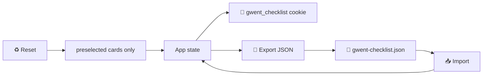
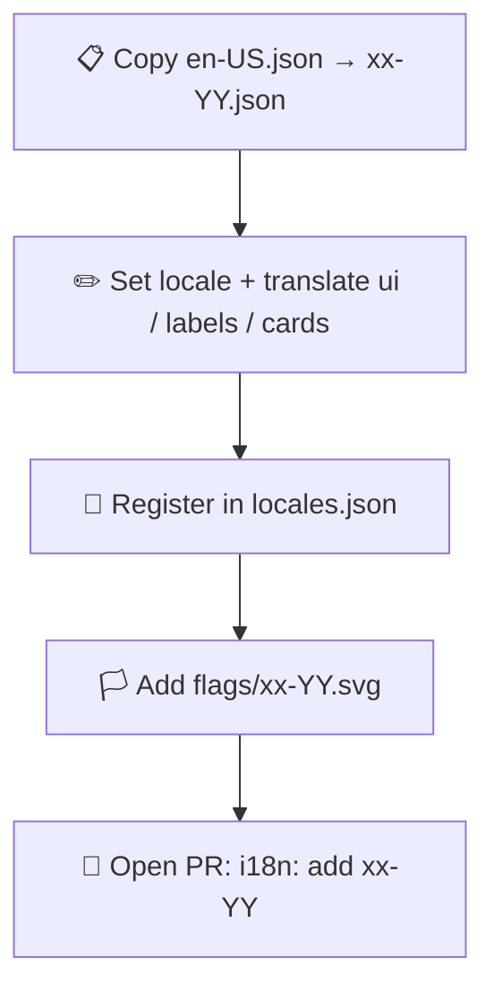

# 🃏 Gwent Checklist

**Languages:** **English** · [Русский](README.ru.md)

> Offline-friendly checklist for **The Witcher 3: Wild Hunt** Gwent cards — track every collectible copy, filter, switch languages, and keep progress in your browser.

Built as a **static site**: root `index.html` → `dist/` bundle + `./data` JSON, images, and flag SVGs. No server, no API, no external runtime requests (catalog and progress stay local).

📘 Deeper docs: [Architecture](docs/architecture.md) · [Development](docs/development.md)

---

## ✨ Features

1. 🗃️ **251 collectible cards** (individual copies, not unique types only)
2. 🔎 **Search** names, flavor, how-to-get, abilities, tags
3. 🏷️ **Combined filters** — faction · type · expansion · row · ability · tags · status
4. 📂 **Collapsible** attribute filters; search + status always visible
5. 🏳️ **Language flags** from `data/translations/flags/{locale}.svg`
6. 🍪 **Cookie persistence** (compact bitfield + language, ~10 years)
7. 💾 **Export / import JSON** backup
8. ♻️ **Reset** → starter deck only (`preselected: true`)
9. 🚀 First visit **pre-marks** starter-deck cards
10. 🪟 **Details modal** for description / abilities / effects
11. 📜 **How to get** always shown on each card
12. 📱 Responsive dense grid · equal-height rows · mark button at bottom

---

## 🧰 Technologies

| Stack | Role |
|--------|------|
| **React 19** | UI & reactive checklist |
| **TypeScript 5.9** | Typed catalog + i18n |
| **Vite 7** | Dev server + static build |
| **Node.js 24** (`.nvmrc`) | Tooling / build only |
| **npm** | Install & scripts |
| Static hosting (e.g. GitHub Pages) | Serve `index.html` + `dist/` + `data/` |
| Cookie + JSON file | Progress without a backend |
| JSON + PNG + SVG under `./data` | Catalog, art, translations |

---

## 🧠 How it works

### 📡 Runtime data (not baked into the JS bundle)

| Step | URL | Contents |
|------|-----|----------|
| 1️⃣ | `./data/data.json` | Attributes + cards + `preselected` |
| 2️⃣ | `./data/translations/locales.json` | Locale list |
| 3️⃣ | `./data/translations/{locale}.json` | `ui` · labels · card text |
| 🏳️ | `./data/translations/flags/{locale}.svg` | Language flag |
| 🖼️ | `./data/images/{imageId}.png` | Card art (lazy) |

### 🍪 Checklist state



- **Cookie:** `v1|{locale}|{base64-bitfield}` — bitfield follows `data.json` card order  
- **JSON export:**

```json
{
  "language": "en-US",
  "gathered": ["uuid-1", "uuid-2"]
}
```

### ⭐ Starter cards (`preselected`)

| Flag | Meaning |
|------|---------|
| `preselected: true` | Given in a starter / base deck |
| Used for | First-visit defaults + **Reset** |

---

## 🎮 Using the checklist

1. 🌐 Open the site  
2. ⭐ Starter-deck cards are gathered by default  
3. 🔎 Search + **Show filters** to narrow  
4. ✅ Click image or **Mark as gathered**  
5. 🪟 **Details** → modal with full info  
6. 🏳️ Flags switch language  
7. 💾 **Export / Import JSON** to move progress  
8. ♻️ **Reset** → only `preselected` cards (confirm)

> ⚠️ Clearing site data clears the cookie — keep a JSON export if you care about progress.

---

## 🌍 Contributing translations (PRs)

Translations are **data-only** — prefer PRs that only touch `data/translations/` (and optional flag SVGs).

### ➕ Add a new language



1. **Copy** template:

   ```bash
   cp data/translations/en-US.json data/translations/pl-PL.json
   ```

2. Set `"locale"` to match the filename (BCP 47), e.g. `"pl-PL"`.

3. Translate all of:
   - 🧩 **`ui`** — buttons, toasts, filters, chrome  
   - 🏷️ **`attributeLabels`** — Faction, Type, How to get, …  
   - 📚 **`attributes.*.*.name` / `description`**  
   - 🃏 **`cards.<uuid>.*`** — `name`, `description`, `howToGet`, `effect?`  

   ⚠️ Keep every UUID key identical to `en-US.json`. Never drop or rename IDs.

4. Register in `locales.json`:

   ```json
   ["en-US", "ru-RU", "pl-PL"]
   ```

5. Add a flag SVG named exactly like the locale:

   ```
   data/translations/flags/pl-PL.svg
   ```

   The UI loads `./data/translations/flags/{locale}.svg` automatically. If the file is missing, a short letter fallback is shown.

6. Open a PR titled like `i18n: add pl-PL` (+ screenshot welcome).

### ✏️ Improve an existing language

- Edit only that locale file  
- Prefer wording fixes over key reshuffles  
- New **`ui` key** → add to **every** locale (at least `en-US` + yours)

### 🚫 Avoid in translation PRs

- Reordering / deleting cards in `data.json`  
- Changing `preselected` unless fixing starter metadata  
- Unrelated CSS / feature refactors  

---

## ⚖️ License & content

- **Code & docs:** [MIT](LICENSE)
- **Game content:** Fan-made tool only. Card names, art, and lore belong to their rights holders (**CD PROJEKT RED** / *The Witcher*). The MIT license does **not** cover those materials.

<p align="center">
  <strong>Good luck on the path — and at the Gwent table. 🐺🃏</strong>
</p>
