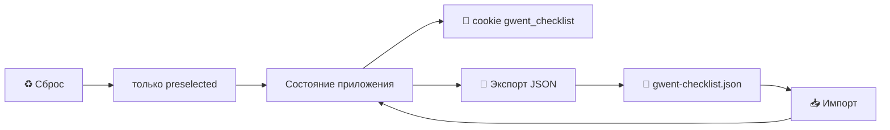
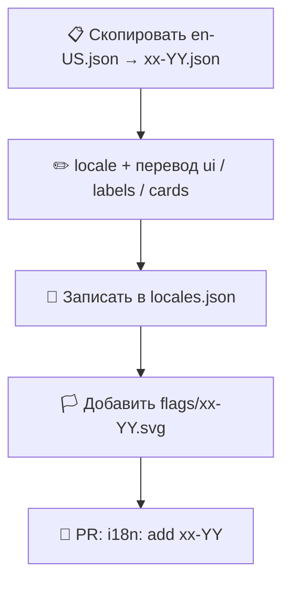

# 🃏 Чек-лист Гвинта

**Языки:** [English](README.md) · **Русский**

> Офлайн-дружелюбный чек-лист карт Гвинта из **The Witcher 3: Wild Hunt** — отмечайте собранные экземпляры, фильтруйте, переключайте язык и сохраняйте прогресс в браузере.

Статический сайт: корневой `index.html` → бандл в `dist/` + данные в `./data` (JSON, картинки, флаги SVG). Без сервера, API и внешних запросов во время работы (каталог и прогресс остаются локальными).

📘 Подробнее: [Архитектура](docs/architecture.md) · [Разработка](docs/development.md) *(на английском)*

> ℹ️ **GitHub не переключает README автоматически** по языку интерфейса пользователя. На главной страницы репозитория всегда показывается `README.md` (английский). Русская версия — отдельный файл со ссылкой сверху.

---

## ✨ Возможности

1. 🗃️ **251 коллекционная карта** (отдельные экземпляры, не только уникальные типы)
2. 🔎 **Поиск** по названию, описанию, способу получения, способностям, тегам
3. 🏷️ **Комбинированные фильтры** — фракция · тип · дополнение · ряд · способность · теги · статус
4. 📂 **Сворачиваемые** фильтры атрибутов; поиск и статус всегда видны
5. 🏳️ **Флаги языков** из `data/translations/flags/{locale}.svg`
6. 🍪 **Сохранение в cookie** (компактный битфилд + язык, ~10 лет)
7. 💾 **Экспорт / импорт JSON**
8. ♻️ **Сброс** → только стартовая колода (`preselected: true`)
9. 🚀 При первом визите **заранее отмечены** карты стартовой колоды
10. 🪟 **Модальное окно** с описанием / способностями / эффектами
11. 📜 Блок **«Как получить»** всегда на карточке
12. 📱 Адаптивная сетка · одинаковая высота в ряду · кнопка отметки снизу

---

## 🧰 Технологии

| Стек | Роль |
|--------|------|
| **React 19** | UI и реактивный чек-лист |
| **TypeScript 5.9** | Типы каталога и i18n |
| **Vite 7** | Dev-сервер и сборка |
| **Node.js 24** (`.nvmrc`) | Только tooling / сборка |
| **npm** | Установка и скрипты |
| Статический хостинг (напр. GitHub Pages) | Раздача `index.html` + `dist/` + `data/` |
| Cookie + JSON-файл | Прогресс без бэкенда |
| JSON + PNG + SVG в `./data` | Каталог, арт, переводы |

---

## 🧠 Как это работает

### 📡 Данные во время работы (не вшиты в JS-бандл)

| Шаг | URL | Содержимое |
|------|-----|----------|
| 1️⃣ | `./data/data.json` | Атрибуты + карты + `preselected` |
| 2️⃣ | `./data/translations/locales.json` | Список локалей |
| 3️⃣ | `./data/translations/{locale}.json` | `ui` · подписи · тексты карт |
| 🏳️ | `./data/translations/flags/{locale}.svg` | Флаг языка |
| 🖼️ | `./data/images/{imageId}.png` | Арт карты (lazy) |

### 🍪 Состояние чек-листа



- **Cookie:** `v1|{locale}|{base64-bitfield}` — битфилд по порядку карт в `data.json`  
- **Экспорт JSON:**

```json
{
  "language": "ru-RU",
  "gathered": ["uuid-1", "uuid-2"]
}
```

### ⭐ Стартовые карты (`preselected`)

| Флаг | Значение |
|------|---------|
| `preselected: true` | Карта из стартовой / базовой колоды |
| Используется для | Значения по умолчанию при первом визите + **Сброс** |

---

## 🎮 Как пользоваться

1. 🌐 Откройте сайт  
2. ⭐ Карты стартовой колоды уже отмечены  
3. 🔎 Поиск + **Показать фильтры**  
4. ✅ Клик по картинке или **Отметить собранной**  
5. 🪟 **Подробнее** → модалка с полной информацией  
6. 🏳️ Флаги переключают язык  
7. 💾 **Экспорт / импорт JSON** для переноса прогресса  
8. ♻️ **Сброс** → только `preselected` карты (с подтверждением)

> ⚠️ Очистка данных сайта стирает cookie — сохраните JSON-экспорт, если прогресс важен.

---

## 🌍 Как присылать переводы (PR)

Переводы — **только данные**. В идеале PR затрагивает лишь `data/translations/` (и при необходимости SVG флагов).

### ➕ Новый язык



1. **Скопируйте** шаблон:

   ```bash
   cp data/translations/en-US.json data/translations/pl-PL.json
   ```

2. Укажите `"locale"` как в имени файла (BCP 47), например `"pl-PL"`.

3. Переведите:
   - 🧩 **`ui`** — кнопки, тосты, фильтры, интерфейс  
   - 🏷️ **`attributeLabels`** — Фракция, Тип, Как получить, …  
   - 📚 **`attributes.*.*.name` / `description`**  
   - 🃏 **`cards.<uuid>.*`** — `name`, `description`, `howToGet`, `effect?`  

   ⚠️ UUID-ключи карт должны совпадать с `en-US.json`. Не удаляйте и не переименовывайте ID.

4. Зарегистрируйте локаль в `locales.json`:

   ```json
   ["en-US", "ru-RU", "pl-PL"]
   ```

5. Добавьте SVG флага с тем же именем, что и локаль:

   ```
   data/translations/flags/pl-PL.svg
   ```

   UI сам подгружает `./data/translations/flags/{locale}.svg`. Если файла нет — показывается буквенный fallback.

6. Откройте PR с заголовком вроде `i18n: add pl-PL` (скриншот приветствуется).

### ✏️ Улучшение существующего языка

- Правите только файл этой локали  
- Лучше правки формулировок, чем перестройка ключей  
- Новый ключ в **`ui`** → добавьте во **все** локали (как минимум `en-US` + ваша)

### 🚫 Не делайте в translation-PR

- Перестановку / удаление карт в `data.json`  
- Смену `preselected`, если это не исправление метаданных стартовой колоды  
- Посторонние правки CSS / фич  

---

## ⚖️ Лицензия и контент

- **Код и документация:** [MIT](LICENSE)
- **Игровой контент:** только фан-проект. Названия карт, арт и лор принадлежат правообладателям (**CD PROJEKT RED** / *The Witcher*). Лицензия MIT на эти материалы **не распространяется**.

<p align="center">
  <strong>Удачи на Тропе — и за столом Гвинта. 🐺🃏</strong>
</p>
