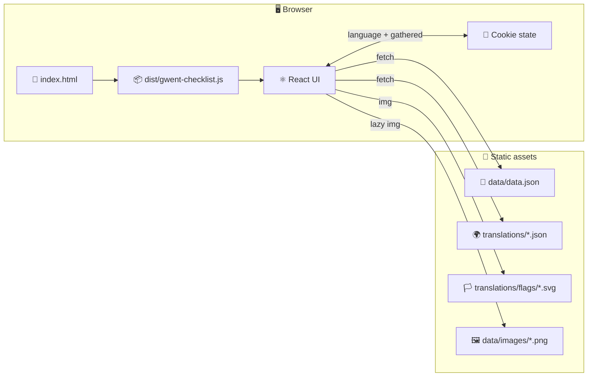
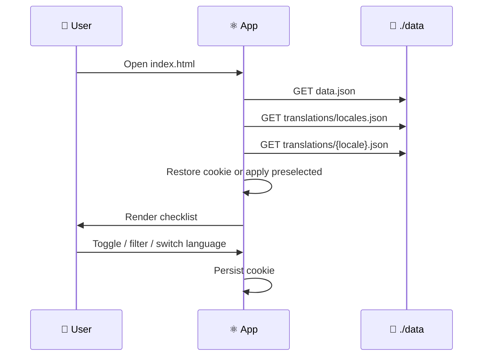
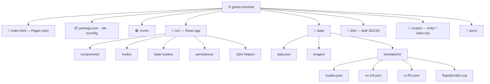
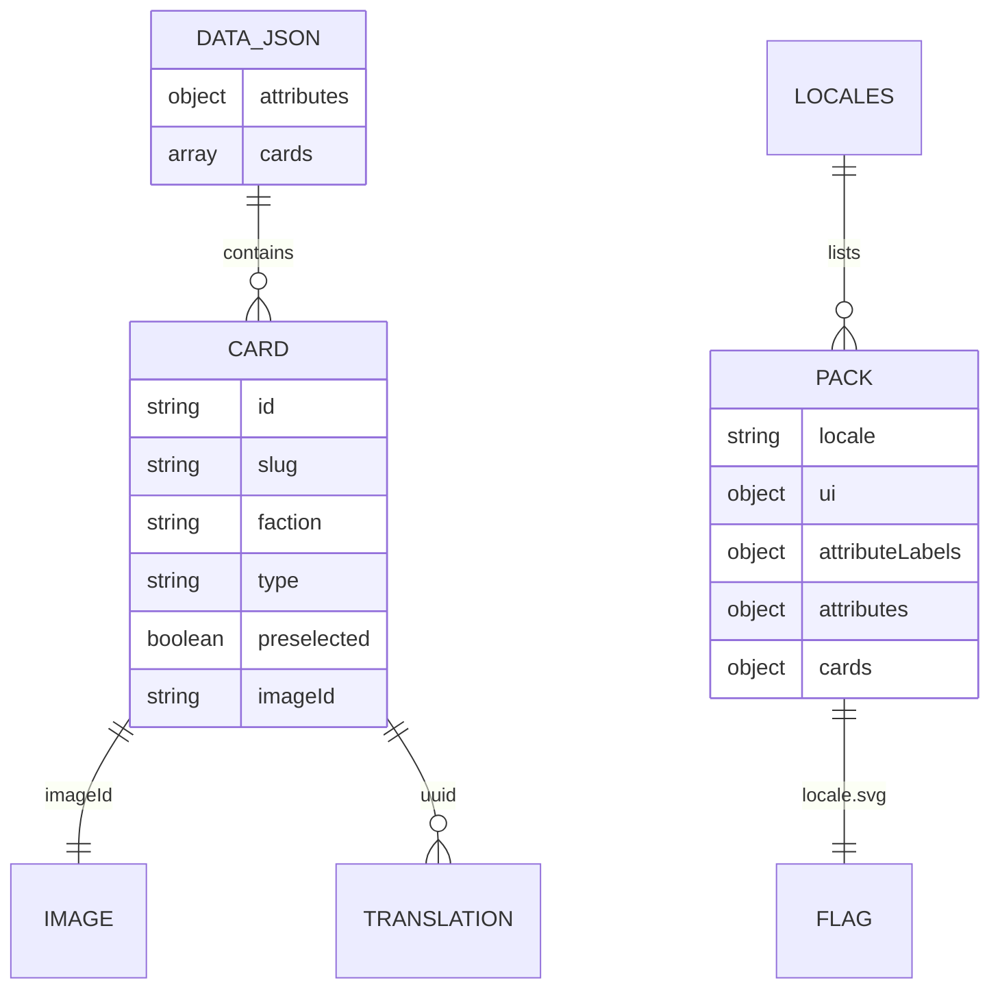
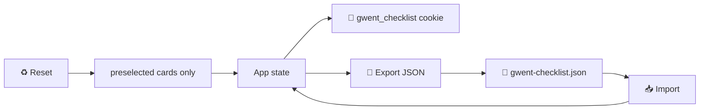

# 🏗️ Architecture

Deep dive for contributors who want to understand how the app is structured. Newcomers can skip this and start with the root [README](../README.md).

---

## 🧱 High-level



---

## 🔄 Startup sequence



---

## 📁 Repository layout



---

## 📐 Data model



### `data/data.json`

- **`attributes`**: allowed values for faction, type, expansion, row, ability  
- **`cards[]`**: `id`, `slug`, faction/type/expansion, `strength`, `row`, `abilities[]`, `tags[]`, `imageId`, `preselected`

### Translation pack shape

```json
{
  "locale": "en-US",
  "ui": { "appTitle": "…", "…": "…" },
  "attributeLabels": { "faction": "Faction" },
  "attributes": {
    "faction": {
      "northern": { "name": "Northern Realms", "description": "…" }
    }
  },
  "cards": {
    "<uuid>": {
      "name": "…",
      "description": "…",
      "howToGet": "…",
      "effect": "…"
    }
  }
}
```

### Flags

`data/translations/flags/{locale}.svg` — same BCP 47 code as the translation file / `locales.json` entry (e.g. `en-US.svg`, `ru-RU.svg`).

---

## 🍪 Persistence



- Cookie format: `v1|{locale}|{base64-bitfield}` (bitfield = card order in `data.json`)  
- JSON export: `{ "language": "en-US", "gathered": ["uuid…"] }`
