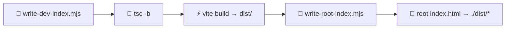

# 🛠️ Development

Local setup, scripts, and build notes for contributors.

---

## ✅ Prerequisites

```bash
nvm use          # 🟢 Node from .nvmrc (24.x)
npm install      # 📦 deps
```

---

## 📜 Scripts

| Command | What it does |
|---------|----------------|
| 🔥 `npm run dev` | Vite HMR (writes dev `index.html`) |
| 🏗️ `npm run build` | `tsc` + Vite → `dist/` + production root `index.html` |
| 🌐 `npm run serve` | Build + serve **repo root** (Pages-like) → http://localhost:4173 |
| 👀 `npm run preview` | Vite preview of `dist/` only |

> 💡 For a true Pages-like check (JS + `./data` images + flags), use **`npm run serve`**.

---

## 🔧 Build pipeline



| Mode | `index.html` behavior |
|------|------------------------|
| Dev | Points at `/src/main.tsx` |
| Build | Root file loads `./dist/gwent-checklist.js` + `.css` |

Always run **`npm run build`** before committing publishable `dist/` + root `index.html`.

---

## 🧰 Stack (quick ref)

| Layer | Choice |
|--------|--------|
| ⚛️ UI | React 19 |
| 🟦 Types | TypeScript 5.9 |
| ⚡ Build | Vite 7 |
| 🟢 Node | 24 LTS (`.nvmrc`) |
| 📦 Packages | npm |

---

## 💡 Ideas for further improvements

| Area | Idea |
|------|------|
| 🤖 CI | Action to build / deploy Pages + lint translation key parity |
| ✅ Lint | Assert every locale has the same `ui` keys & card IDs as `en-US` |
| 📜 Virtualize | Windowed grid if catalog grows well past ~250 |
| 🔗 Share | Compressed progress in URL hash |
| 📦 Bulk | Mark / clear all visible (with confirm) |
| 📴 PWA | Service worker cache for images |
| ♿ A11y | Stronger modal focus trap & shortcuts |
| 🌐 i18n | More locales + clearer how-to-get wording |
